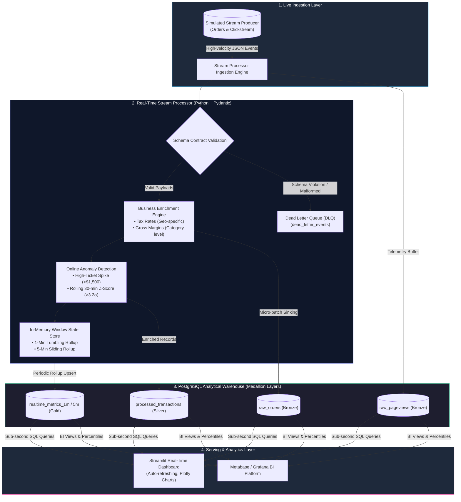

<h1 align="center">⚡ Real-Time Data Analytics Dashboard Pipeline</h1>

<p align="center">
  
  
  
  
  
  
  
</p>

<p align="center">
  <strong>An end-to-end event-driven streaming pipeline ingesting live e-commerce telemetry, performing online window aggregations, detecting real-time fraud & anomalies, and powering interactive Streamlit & Metabase dashboards.</strong>
</p>

---

## 📖 Executive Summary & Architecture

Modern digital platforms demand sub-second visibility into revenue momentum, payment gateway health, and security anomalies. Traditional batch ELT architectures introduce lag times of hours or days, causing missed fraud alerts and delayed incident response.

This project delivers a **production-grade Real-Time Data Analytics Pipeline** capable of processing continuous event streams (transactions and browsing clickstreams) with sub-second latency, rigorous Pydantic schema validation, Dead Letter Queue (DLQ) fault isolation, and automated online anomaly detection.

### 🏛️ High-Level System Architecture



---

## ✨ Key Engineering Features

1. **High-Throughput Micro-Batch Ingestion**:
   - Accumulates streaming events into configurable micro-batches (50 events or 2.0s flush intervals) using PostgreSQL `execute_values` for high ingestion throughput.
2. **Strict Schema Contract & Dead Letter Queue (DLQ)**:
   - Validates incoming payloads using Pydantic v2 models. Corrupted, missing, or malformed data is automatically quarantined into `dead_letter_events` with detailed diagnostic stack traces without interrupting stream processing.
3. **Dual-Engine Flexibility (PostgreSQL + SQLite Fallback)**:
   - Seamlessly operates against a pooled PostgreSQL cluster (`ThreadedConnectionPool`) with exponential backoff retries, while providing a zero-dependency SQLite fallback mode for immediate local development.
4. **Online Statistical Anomaly Detection**:
   - Detects fraud and abnormal purchasing bursts using two complementary mechanisms:
     - Absolute ticket threshold checks ($1,500+).
     - Online rolling Z-score outlier detection ($> 3.2\sigma$) against recent transaction baselines.
5. **Windowed Metrics Accumulation**:
   - Tracks real-time tumbling (1-minute) and sliding (5-minute) windows in-memory before committing unified rollups (`total_orders`, `revenue`, `aov`, `anomaly_count`) to analytical storage.
6. **Advanced SQL Analytical Arsenal**:
   - Contains 10 production-ready queries utilizing window functions (`AVG() OVER`, `DENSE_RANK()`, `LAG()`), continuous percentile distributions (`percentile_cont`), and multi-stage conversion funnels.
7. **Interactive Real-Time Dashboard**:
   - Streamlit interface with dynamic auto-refresh, glassmorphism theme, Plotly interactive charts, live telemetry cards, and manual event simulation injection buttons.

---

## 📊 Database Schema (Medallion Structure)

| Table Name | Layer | Description | Key Indexes |
| :--- | :--- | :--- | :--- |
| `raw_orders` | **Bronze** | Raw transactional order events ingested directly from stream | `created_at DESC`, `customer_id`, `category`, `status` |
| `raw_pageviews` | **Bronze** | High-velocity clickstream browsing telemetry | `created_at DESC`, `(session_id, user_id)`, `page_type` |
| `processed_transactions` | **Silver** | Enriched orders with computed tax, margins, and anomaly flags | `created_at DESC`, `(status, created_at)`, `is_fraud_anomaly` |
| `dead_letter_events` | **Silver** | Quarantined malformed payloads with error reasons | `failed_at DESC`, `event_type` |
| `realtime_metrics_1m` | **Gold** | 1-minute tumbling window rollups for rapid KPI dashboarding | Primary key: `window_start` |
| `realtime_metrics_5m` | **Gold** | 5-minute sliding window rollups for trend smoothing | Primary key: `window_start` |

---

## 🚀 Quickstart Guide

### Option 1: One-Click Launch via Docker Compose (Recommended)

Spins up PostgreSQL 16, initializes tables via DDL, starts the stream generator pipeline, and launches the Streamlit dashboard:

```bash
# Clone the repository
git clone https://github.com/prabhat84sharma-ui/real-time-data-analytics-dashboard.git
cd real-time-data-analytics-dashboard

# Start the complete containerized stack
docker compose up -d --build

# Inspect running services
docker compose ps
```

- **Streamlit Dashboard**: Open [http://localhost:8501](http://localhost:8501)
- **Metabase BI**: Open [http://localhost:3000](http://localhost:3000)
- **PostgreSQL Connection**: `localhost:5432` | DB: `realtime_analytics` | User: `postgres` | Password: `postgres`

---

### Option 2: Local Standalone Setup (Zero-Config Mode)

Run directly on your local machine using virtual environments and the automatic SQLite fallback engine:

```bash
# 1. Create and activate a Python virtual environment
python -m venv .venv
source .venv/bin/activate  # On Windows: .venv\Scripts\activate

# 2. Install dependencies
pip install -r requirements.txt

# 3. Run stream processor and generator pipeline
python -m src.stream_processor --rate 15 --count 150

# 4. In a separate terminal, launch the Streamlit dashboard
streamlit run src/dashboard.py
```

---

## 📈 Real-Time Analytical Queries Showcase

Below are highlights of the analytical queries located in [`sql/real_time_queries.sql`](file:///sql/real_time_queries.sql):

### 1. Rolling 5-Minute Moving Average & Cumulative Running Revenue
```sql
WITH minute_revenue AS (
    SELECT
        date_trunc('minute', created_at) AS order_minute,
        COUNT(order_id) AS orders_count,
        SUM(CASE WHEN status = 'COMPLETED' THEN total_amount ELSE 0 END) AS completed_revenue
    FROM raw_orders
    WHERE created_at >= NOW() - INTERVAL '1 hour'
    GROUP BY date_trunc('minute', created_at)
)
SELECT
    order_minute,
    orders_count,
    completed_revenue,
    SUM(completed_revenue) OVER (
        ORDER BY order_minute
        ROWS BETWEEN UNBOUNDED PRECEDING AND CURRENT ROW
    ) AS cumulative_running_revenue,
    ROUND(
        AVG(completed_revenue) OVER (
            ORDER BY order_minute
            ROWS BETWEEN 4 PRECEDING AND CURRENT ROW
        ), 2
    ) AS rolling_5m_avg_revenue
FROM minute_revenue
ORDER BY order_minute DESC;
```

### 2. Multi-Stage Clickstream Conversion Funnel Analysis
```sql
WITH user_stages AS (
    SELECT
        session_id, user_id,
        MAX(CASE WHEN page_type = 'home' THEN 1 ELSE 0 END) AS visited_home,
        MAX(CASE WHEN page_type = 'search' THEN 1 ELSE 0 END) AS visited_search,
        MAX(CASE WHEN page_type = 'product_detail' THEN 1 ELSE 0 END) AS visited_product,
        MAX(CASE WHEN page_type = 'checkout' THEN 1 ELSE 0 END) AS visited_checkout
    FROM raw_pageviews
    WHERE created_at >= NOW() - INTERVAL '30 minutes'
    GROUP BY session_id, user_id
)
SELECT
    COUNT(DISTINCT s.session_id) AS total_sessions,
    SUM(s.visited_home) AS stage_1_home,
    SUM(s.visited_search) AS stage_2_search,
    SUM(s.visited_product) AS stage_3_product_detail,
    SUM(s.visited_checkout) AS stage_4_checkout,
    ROUND(SUM(s.visited_checkout)::NUMERIC / NULLIF(COUNT(DISTINCT s.session_id), 0) * 100, 2) AS checkout_rate_pct
FROM user_stages s;
```

---

## 🧪 Testing & Validation

The test suite thoroughly exercises contract validation, margin algorithms, statistical anomaly alerts, and window aggregations:

```bash
# Run pytest test suite with short tracebacks
pytest tests/ -v --tb=short
```

```text
============================= test session starts =============================
tests/test_stream_processor.py::test_valid_order_schema PASSED            [ 11%]
tests/test_stream_processor.py::test_invalid_order_negative_quantity PASSED [ 22%]
tests/test_stream_processor.py::test_invalid_order_bad_status PASSED     [ 33%]
tests/test_stream_processor.py::test_valid_pageview_schema PASSED         [ 44%]
tests/test_stream_processor.py::test_invalid_pageview_page_type PASSED   [ 55%]
tests/test_stream_processor.py::test_tax_and_margin_enrichment PASSED    [ 66%]
tests/test_stream_processor.py::test_high_value_anomaly_detection PASSED [ 77%]
tests/test_stream_processor.py::test_statistical_outlier_zscore_detection PASSED [ 88%]
tests/test_stream_processor.py::test_dead_letter_queue_routing PASSED    [100%]
============================== 9 passed in 0.42s ==============================
```

---

## 📂 Repository File Structure

```text
real-time-data-analytics-dashboard/
├── .gitignore                      # Python, IDE, and database exclusions
├── Dockerfile                      # Container build definition
├── Makefile                        # Development automation commands
├── README.md                       # Comprehensive documentation & architecture
├── docker-compose.yml              # PostgreSQL, Pipeline, Dashboard, Metabase stack
├── requirements.txt                # Pinned production dependencies
├── config/
│   ├── __init__.py
│   └── settings.py                 # Pydantic Settings & environment manager
├── sql/
│   └── real_time_queries.sql       # DDL definitions & 10 real-time analytical queries
├── src/
│   ├── __init__.py
│   ├── dashboard.py                # Streamlit interactive real-time dashboard
│   ├── database.py                 # PostgreSQL connection pool & bulk operations
│   ├── data_generator.py           # Synthetic stream generator & anomaly simulator
│   └── stream_processor.py         # Ingestion, validation, enrichment & windowing
└── tests/
    └── test_stream_processor.py    # Pytest test suite
```

---

## 👤 Author & Contact

**Prabhat Sharma**  
*Data Engineer | Data Analyst | Cloud Data Architect*

- 🌐 **GitHub**: [@prabhat84sharma-ui](https://github.com/prabhat84sharma-ui)
- 💼 **LinkedIn**: [Prabhat Sharma](https://linkedin.com/in/prabhat-sharma-4279b1241)
- ✉️ **Email**: [prabhat84sharma@gmail.com](mailto:prabhat84sharma@gmail.com)
